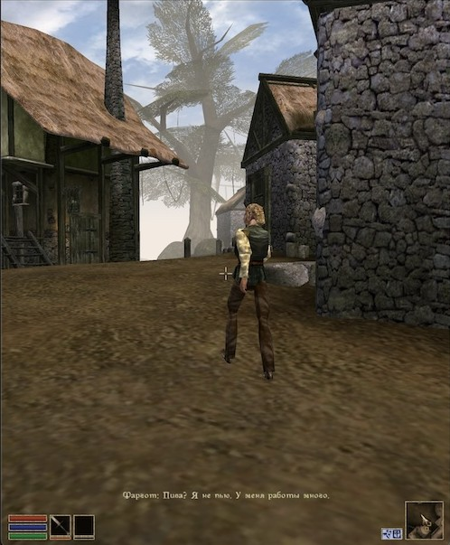
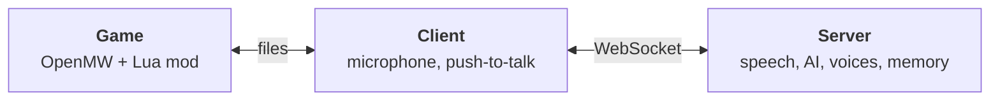

<div align="center">


# Zdo RPG AI

**Morrowind talks back.**

Hold Y and talk to anyone in Vvardenfell. They answer in their own voice, remember you, and when you strike a deal, they actually do it.

[Website](https://megative.github.io/zdo-rpg-ai/) · [Install](https://megative.github.io/zdo-rpg-ai/install/) · [Configure](https://megative.github.io/zdo-rpg-ai/configuration/) · [Play](https://megative.github.io/zdo-rpg-ai/playing/) · [По-русски](https://megative.github.io/zdo-rpg-ai/ru/)



</div>

## What it does

- **Voice or text.** Hold the push-to-talk key and speak, in any language, or press Enter and type. The NPC turns to you and answers out loud, with subtitles and a voice that suits their race.
- **They remember you.** Each NPC gets a character and a memory of you, separate for every save. Come back later and they greet you first.
- **They know only their part.** Your journal is seen by those in the quest, a secret faction by its members, and what you said by whoever stood close.
- **They act on it.** Items and gold change hands for real, checked against both inventories. NPCs follow you, fight, warm up or cool down to you, and open their trade, training and travel windows.
- **Companions.** Whoever comes along has a word on arriving somewhere new, and speaks up on a quiet road.
- **The town has a life.** Neighbours chat among themselves, bystanders cut in, and a fight or a gift is known around town a couple of game hours later.
- **Tasks and quests.** NPCs give tasks of their own with real rewards and hand the game's quests over to its own dialogue. Small multi-step quests are there to try, as an alpha.
- **In-game log.** L shows what you got and were asked to do; press again for the conversation.
- **Any model.** Claude, OpenAI or Gemini, or everything local. A settings panel in the browser lists the models and checks your keys.

The website walks through [each new feature step by step](https://megative.github.io/zdo-rpg-ai/#guide), [по-русски тоже](https://megative.github.io/zdo-rpg-ai/ru/#guide).

## How it works



- The **mod** knows who is around and what they carry. It shows subtitles, plays voices, carries out NPC actions and keeps the log.
- The **client** records your voice while you hold the key and passes messages between the game and the server.
- The **server** turns speech into text, asks the AI what the NPC says and does, voices the answer and keeps every NPC's memory. It can run on another machine.

## Quick start

You need OpenMW 0.50 or newer with Morrowind, the .NET SDK 9 or newer, ffmpeg, a microphone, and keys for the AI services or local models. The website has step-by-step guides for [Windows](https://megative.github.io/zdo-rpg-ai/install/windows/), [Linux](https://megative.github.io/zdo-rpg-ai/install/linux/) and [macOS](https://megative.github.io/zdo-rpg-ai/install/macos/); in short:

```sh
git clone https://github.com/megative/zdo-rpg-ai
git clone https://github.com/megative/zdo-rpg-ai-openmw-mod

cd zdo-rpg-ai
mkdir -p .tmp
cp example/server-config.example.yaml .tmp/server-config.yaml   # pick the AI, add your keys
cp example/client-config.example.yaml .tmp/client-config.yaml   # paths to the mod and openmw.log
./run.sh                                                         # builds and starts the server and the client
```

Add the mod to `openmw.cfg`, then start the game and load a save:

```ini
data="/path/to/zdo-rpg-ai-openmw-mod/zdorpgai"
content=zdorpgai.omwscripts
```

On Windows, start the server and the client with `dotnet run` in two terminals, as the [Windows guide](https://megative.github.io/zdo-rpg-ai/install/windows/) shows.

## AI services

| | Providers |
|---|---|
| Conversations | Claude, OpenAI, Gemini, or any OpenAI-compatible server such as Ollama |
| Speech recognition | OpenAI Whisper or a compatible server such as speaches, Deepgram |
| Voices | OpenAI or a compatible server such as speaches, ElevenLabs |

Ready-made setups, from Claude with OpenAI voices to fully local, are on the [Configure](https://megative.github.io/zdo-rpg-ai/configuration/) page.

## Repository

| Path | What's there |
|---|---|
| `src/ZdoRpgAi.Server*` | The server: speech, the AI director, voices, memory |
| `src/ZdoRpgAi.Client*` | The client: microphone, push-to-talk, the link to the mod |
| `src/ZdoRpgAi.Protocol` | Messages between the server, the client and the mod |
| `src/ZdoRpgAi.ModEmulator*` | A stand-in for the game: by hand without OpenMW, or playing scenarios against the server in-process |
| `tests/` | Tests, with the server's game part run against the emulated game |
| `eval/scenarios/` | Scenarios that check how a model plays NPCs |
| `example/` | Example configs |
| `website/` | The website, built with [Material for MkDocs](https://squidfunk.github.io/mkdocs-material/) |

Run the tests, then play the scenarios with the models of your config (each run spends a few tokens); the [Scenarios](https://megative.github.io/zdo-rpg-ai/scenarios/) page explains the format:

```sh
dotnet test
dotnet run --project src/ZdoRpgAi.ModEmulator.Console -- --scenarios eval/scenarios --config .tmp/server-config.yaml --report report.md
```

The mod's tests run with Lua 5.4 or newer, from the mod's repository: `lua tests/mod_test.lua` and `lua tests/scene_secrets_test.lua`.

Preview the website locally:

```sh
pip install -r website/requirements.txt
mkdocs serve -f website/mkdocs.yml
```

Pushes to `main` that touch `website/` publish it to GitHub Pages.

## Credits

- [drzdo](https://github.com/drzdo) created Zdo RPG AI and its OpenMW mod, an evolution of [immersive_morrowind_llm_ai](https://github.com/drzdo/immersive_morrowind_llm_ai).
- [waterbobo24](https://github.com/waterbobo24): richer NPC and player context, in-game time, item transfers and per-save memory are ported from their forks [Morrowind-llm-server-client](https://github.com/waterbobo24/Morrowind-llm-server-client) and [Morrowind-llm-mod](https://github.com/waterbobo24/Morrowind-llm-mod).
- [megative](https://github.com/megative) maintains this fork: voices, Claude, tasks and quests, banter, rumors, companions, the in-game log, typing, the settings panel and test scenarios.

## License

[GPL-3.0](LICENSE). Morrowind is a trademark of Bethesda Softworks; this project is not affiliated with Bethesda or the OpenMW team.
