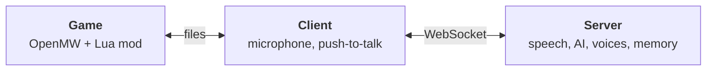

<div align="center">


# Zdo RPG AI

**Morrowind talks back.**

Walk up to anyone in Vvardenfell, hold a key and say what you want. They answer in their own voice, remember you, haggle, follow you or pick a fight, gossip about what you did, and keep the game's quests intact.

[Website](https://megative.github.io/zdo-rpg-ai/) · [Install](https://megative.github.io/zdo-rpg-ai/install/) · [Configure](https://megative.github.io/zdo-rpg-ai/configuration/) · [Play](https://megative.github.io/zdo-rpg-ai/playing/) · [По-русски](https://megative.github.io/zdo-rpg-ai/ru/)


</div>

## What it does

- **Talk with your voice.** Hold the push-to-talk key and speak, in any language. The NPC turns to you and answers out loud, with subtitles and a voice that suits their race and sex.
- **They remember you.** Each NPC gets a character of their own and remembers what you said and did, separately for every save. Come back later and they greet you first.
- **They act, not just talk.** Gifts, payments and bribes move real items and gold, checked against both inventories. NPCs follow you, fight, warm up or cool down to you, and open their trade, training, travel, spell and repair windows.
- **The town talks.** Go quiet, and people nearby chat among themselves. Your deeds travel as rumors.
- **Quests stay intact.** NPCs read your journal and know the quest steps the game gives through them; when a quest is at stake, they hand you over to the game's own dialogue and name the topic to pick. They also give small tasks of their own, with real rewards.
- **True to the lore.** Mention a place or a topic, and the NPC recalls what they would say about it in the original dialogue.
- **Your choice of AI.** Claude, OpenAI or Gemini, or everything local.
- **Windows, Linux, macOS.** Wherever OpenMW runs, including its Windows build under Wine or Proton.

## A taste

Unscripted lines from a real playthrough, translated from Russian:

> **You, to Fargoth:** Fargoth, I apologized. I want my torch.
>
> **Fargoth:** Yes, yes, I heard! Sellus says you mumbled like a drunken netch, but he accepted it. The mayor keeps his word: here's your torch, take it!
>
> *Fargoth gives you a torch and marks his task done.*

Later, with the player standing nearby, Fargoth brags to a guard that he apologized to Ganciel Duar himself. "Nobody elected you mayor, Fargoth," she says.

## How it works



- The **mod** knows who is around, what they carry and what your journal says. It shows subtitles, plays voices and carries out NPC actions.
- The **client** records your voice while you hold the key and passes messages between the game and the server.
- The **server** turns speech into text, asks the AI what the NPC says and does, voices the answer and keeps every NPC's memory. It can run on another machine.

## Quick start

You need OpenMW 0.50 or newer with Morrowind, the .NET SDK 9 or newer, ffmpeg, a microphone, and keys for the AI services or local models. The website has step-by-step guides for [Windows](https://megative.github.io/zdo-rpg-ai/install/windows/), [Linux](https://megative.github.io/zdo-rpg-ai/install/linux/) and [macOS](https://megative.github.io/zdo-rpg-ai/install/macos/); in short:

```sh
git clone https://github.com/megative/zdo-rpg-ai
git clone https://github.com/megative/zdo-rpg-ai-openmw-mod

cd zdo-rpg-ai
mkdir -p .tmp
cp example/server-config.example.yaml .tmp/server-config.yaml   # pick the AI, add your keys
cp example/client-config.example.yaml .tmp/client-config.yaml   # paths to the mod and openmw.log
./run.sh                                                         # builds and starts the server and the client
```

Add the mod to `openmw.cfg`, then start the game and load a save:

```ini
data="/path/to/zdo-rpg-ai-openmw-mod/zdorpgai"
content=zdorpgai.omwscripts
```

On Windows, start the server and the client with `dotnet run` in two terminals, as the [Windows guide](https://megative.github.io/zdo-rpg-ai/install/windows/) shows.

## AI services

| | Providers |
|---|---|
| Conversations | Claude, OpenAI, Gemini, or any OpenAI-compatible server such as Ollama |
| Speech recognition | OpenAI Whisper or a compatible server such as speaches, Deepgram |
| Voices | OpenAI or a compatible server such as speaches, ElevenLabs |

Ready-made setups, from Claude with OpenAI voices to fully local, are on the [Configure](https://megative.github.io/zdo-rpg-ai/configuration/) page.

## Repository

| Path | What's there |
|---|---|
| `src/ZdoRpgAi.Server*` | The server: speech, the AI director, voices, memory |
| `src/ZdoRpgAi.Client*` | The client: microphone, push-to-talk, the link to the mod |
| `src/ZdoRpgAi.Protocol` | Messages between the server, the client and the mod |
| `src/ZdoRpgAi.ModEmulator.Console` | A stand-in for the game, for testing without OpenMW |
| `example/` | Example configs |
| `website/` | The website, built with [Material for MkDocs](https://squidfunk.github.io/mkdocs-material/) |

Preview the website locally:

```sh
pip install -r website/requirements.txt
mkdocs serve -f website/mkdocs.yml
```

Pushes to `main` that touch `website/` publish it to GitHub Pages.

## Credits

- [drzdo](https://github.com/drzdo) created Zdo RPG AI and its OpenMW mod, an evolution of [immersive_morrowind_llm_ai](https://github.com/drzdo/immersive_morrowind_llm_ai).
- [waterbobo24](https://github.com/waterbobo24): richer NPC and player context, in-game time, item transfers and per-save memory are ported from their forks [Morrowind-llm-server-client](https://github.com/waterbobo24/Morrowind-llm-server-client) and [Morrowind-llm-mod](https://github.com/waterbobo24/Morrowind-llm-mod).
- [megative](https://github.com/megative) maintains this fork.

## License

[GPL-3.0](LICENSE). Morrowind is a trademark of Bethesda Softworks; this project is not affiliated with Bethesda or the OpenMW team.
